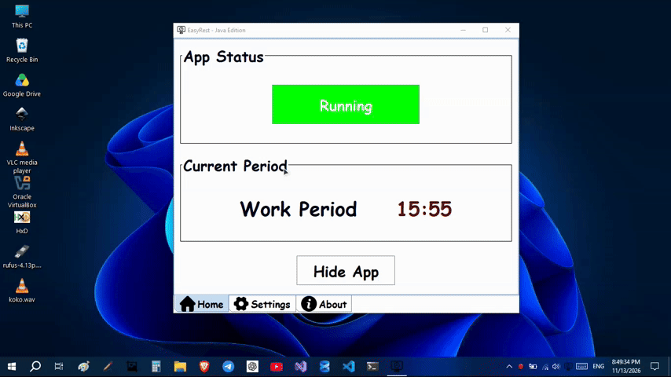

# EasyRest — Java Edition

A lightweight, cross-platform work and rest reminder built with **Java and Swing**.

EasyRest helps you maintain a balanced work routine by alternating between customizable work and rest periods, with several alarm options to remind you when it's time to switch.



## Features

- **Customizable Periods:** Set the duration of your work and rest periods independently.
- **Multiple Alarm Types:** Choose between a full-screen overlay, sound-only alarm, or desktop notification.
- **Multi-Monitor Support:** Overlay alarms appear across all connected displays.
- **Custom Alarm Sounds:** Choose different WAV sounds for work and rest periods.
- **System Tray Integration:** Keep EasyRest running in the background and control it through the tray menu.
- **Silent Mode:** Launch the application directly in the background using the `-silent` argument.
- **Persistent Settings:** Your period configurations and preferences are saved between sessions.

## Download & Run

1. Download the latest ZIP package from [Releases](https://github.com/maketmimi/EasyRest_JavaEdition/releases).
2. Extract the ZIP archive.
3. Run the `EasyRest_JavaEdition.jar` file.

Alternatively, you can launch EasyRest from the command line:

```bash
java -jar EasyRest_JavaEdition.jar
```

To start it silently in the background:

```bash
java -jar EasyRest_JavaEdition.jar -silent
```

Keep the `assets` directory alongside the JAR file when running the application.

## About This Project

EasyRest Java Edition is my first complete application developed using Java and Swing. It was built as a practical learning project alongside my Java studies at college, based on an earlier version I developed using C# and Windows Forms.

The Java edition brings the same core functionality to a cross-platform environment. Automatic startup configuration, available in the original C# edition, is not currently supported.

## Links

- [Original C# Edition](https://github.com/maketmimi/EasyRest)
- [Project Website](https://easyrest.altamimi.ly)
- [My Portfolio](https://altamimi.ly)

---

Developed by **Malek Altamimi**.